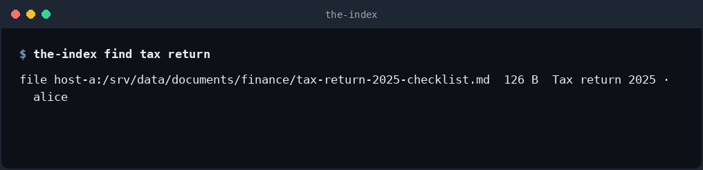
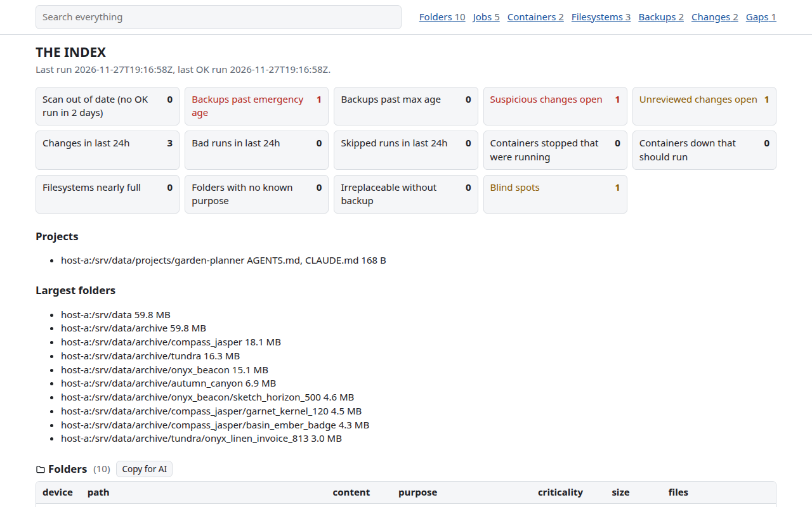
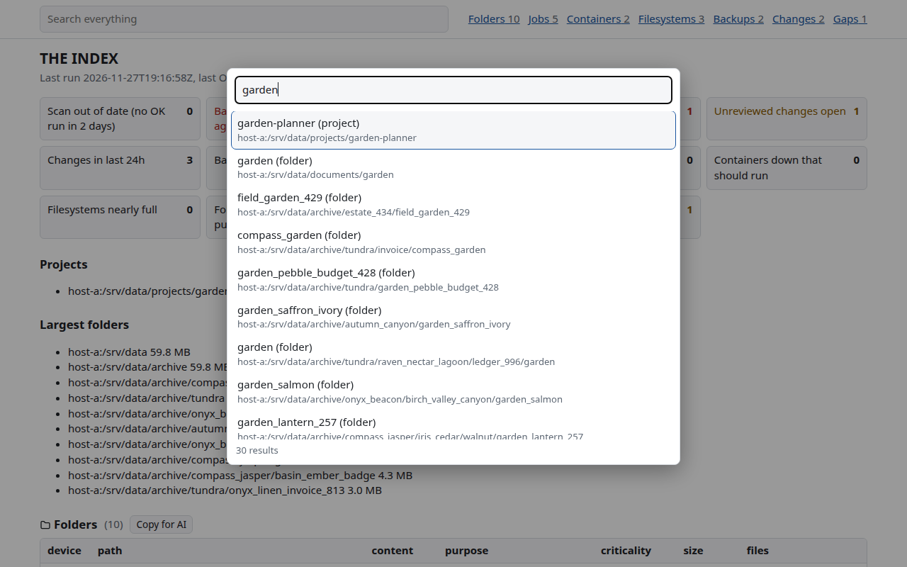
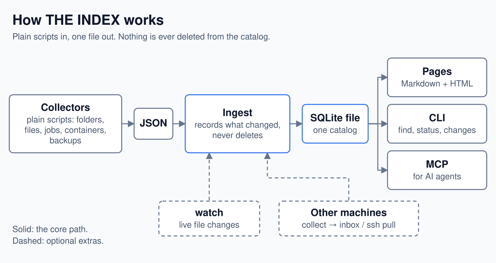

<p align="center">
  <picture>
    <source media="(prefers-color-scheme: dark)" srcset="docs/assets/mark-dark_v2.png">
    
  </picture>
</p>

<h1 align="center">THE INDEX</h1>

<p align="center"><em>A catalog your AI can search: what is on your machines, and what changed.</em></p>

<p align="center">
  <a href="LICENSE"></a>
  <a href="https://github.com/JR91387/THE_INDEX_FILE_SEARCH/wiki/Install"></a>
  <a href="pyproject.toml"></a>
  <a href="https://github.com/JR91387/THE_INDEX_FILE_SEARCH/wiki/FAQ"></a>
  <a href="CHANGELOG.md"></a>
</p>

<p align="center">
  
</p>

THE INDEX keeps one small catalog of what exists on your machines (folders, documents, scheduled jobs,
containers, backups) and tells you what changed since last time. It is for anyone who has lost track of
what is where, and for the AI agents that help them; plain scripts do the work, so no AI tokens are spent scanning.

**[Wiki](https://github.com/JR91387/THE_INDEX_FILE_SEARCH/wiki)** · [Install](https://github.com/JR91387/THE_INDEX_FILE_SEARCH/wiki/Install) · [Guide](https://github.com/JR91387/THE_INDEX_FILE_SEARCH/wiki/Guide) · [FAQ](https://github.com/JR91387/THE_INDEX_FILE_SEARCH/wiki/FAQ) · [AI agents](https://github.com/JR91387/THE_INDEX_FILE_SEARCH/wiki/AI-Agents) · [Changelog](CHANGELOG.md)

> Status: pre-alpha. Linux is tested; macOS and Windows code exists but has not been tried on a real machine yet.

## Features

- **Finds folders and documents fast.** `the-index find` matches names, words inside names, document titles and
  front matter (author, tags) in milliseconds, for you or your AI agent (`--json`, MCP).
- **Planned vs. suspicious change.** Declare a change ahead of time and it shows as expected; anything
  undeclared is flagged for review.
- **Blind spots are listed.** Folders it cannot read and machines it cannot reach are on the front page,
  never silently skipped.
- **Nothing is erased.** Things that disappear are marked retired, so history stays.
- **No dependencies.** Python 3.11+ standard library only; one file to copy, or one zip on Windows.
- **Quiet.** Runs on a schedule at low priority; optional live updates with `the-index watch`.

### The front page

<p align="center">
  <picture>
    <source media="(prefers-color-scheme: dark)" srcset="docs/assets/front-page-dark_v1.png">
    
  </picture>
</p>

### Find anything, from the page or the terminal

<p align="center">
  <picture>
    <source media="(prefers-color-scheme: dark)" srcset="docs/assets/finder-dark_v1.png">
    
  </picture>
</p>

## Quick start

```bash
pip install git+https://github.com/JR91387/THE_INDEX_FILE_SEARCH.git
the-index scan              # first run: creates the database, runs the collectors, writes the pages
the-index find tax return   # folders and documents by name, title or tag
```

Then `the-index schedule` runs the scan daily in the background, `the-index status` prints the front page and
`the-index serve` opens the review page on 127.0.0.1. More in the [Guide](https://github.com/JR91387/THE_INDEX_FILE_SEARCH/wiki/Guide); Windows and the
single-file build are in [Install](https://github.com/JR91387/THE_INDEX_FILE_SEARCH/wiki/Install).

## How it works

<p align="center"></p>

Collectors are small standalone scripts that print what they see as JSON; they run locally, or over ssh on
other machines. Ingest compares each run with the last one, records what changed and classifies it (expected,
routine, suspicious, unreviewed), then the pages, the CLI and the MCP server read the same SQLite file.
Details: [docs/DESIGN.md](docs/DESIGN.md).

## Use with an AI agent

`the-index mcp` is a read-only MCP server on stdin/stdout:

```json
{"mcpServers": {"the-index": {"command": "the-index", "args": ["mcp"]}}}
```

Tools: `find`, `tree`, `projects`, `folder`, `changes`, `describe`. See [AI agents](https://github.com/JR91387/THE_INDEX_FILE_SEARCH/wiki/AI-Agents).

## Your data

Everything stays on your machine: no telemetry, and no network calls except the ones you set up (ssh to
machines you name, a python.org download for the Windows build). It stores names, sizes, dates, titles and
front matter, never file contents. Full details: [PRIVACY.md](PRIVACY.md).

## Contributing

See [CONTRIBUTING.md](CONTRIBUTING.md); AI coding agents read [AGENTS.md](AGENTS.md). Security reports:
[SECURITY.md](SECURITY.md).

## License

MIT. See [LICENSE](LICENSE). Bundled icons: Tabler Icons (MIT), see [THIRD_PARTY_NOTICES.md](THIRD_PARTY_NOTICES.md).
